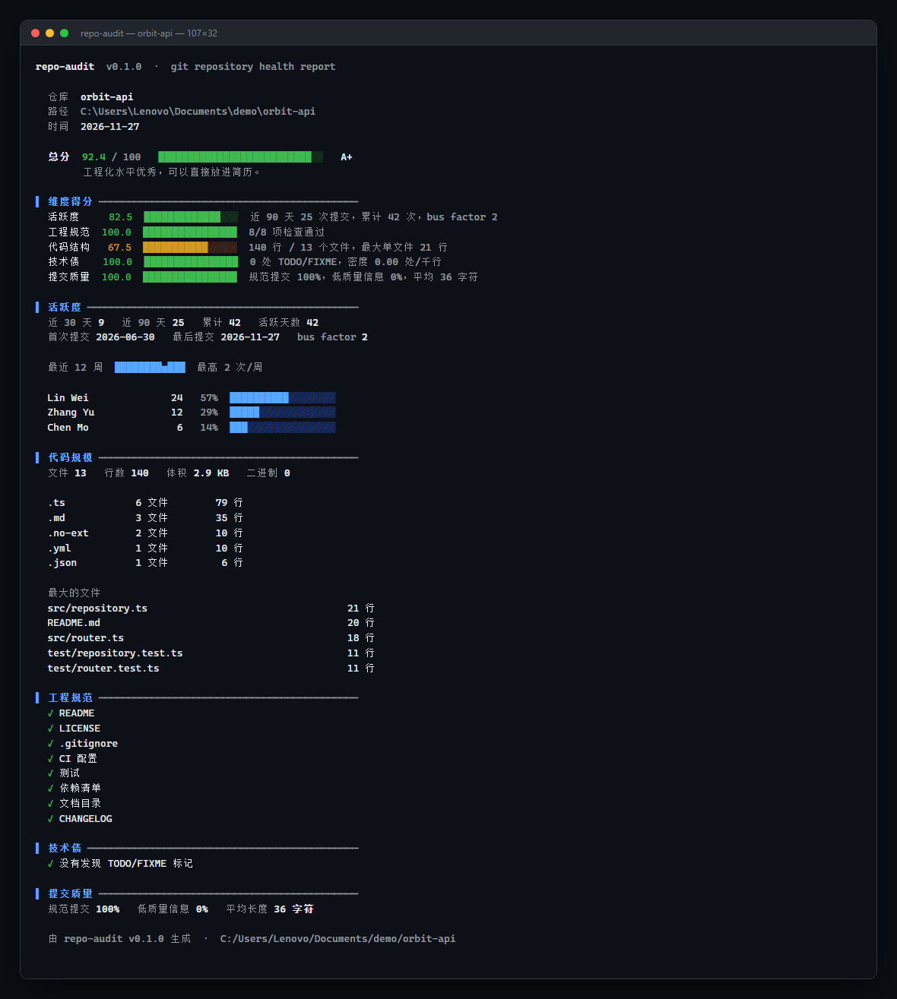
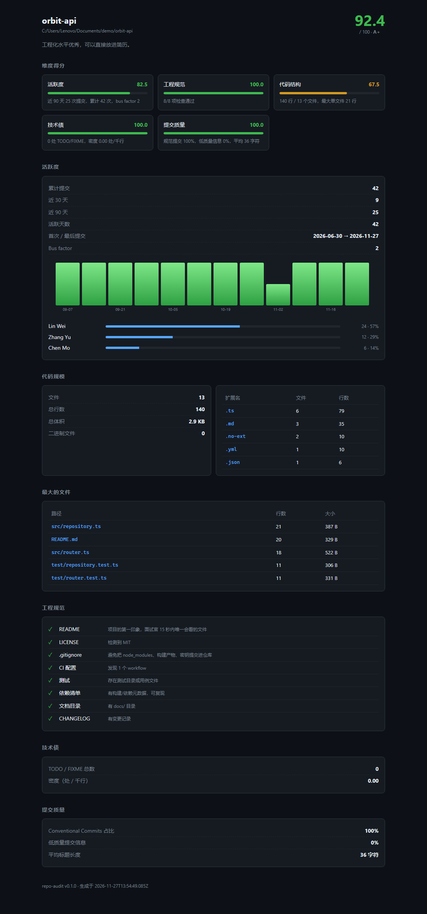

# repo-audit

> 一条命令，给你的 Git 仓库做一次体检：活跃度、工程规范、代码结构、技术债、提交质量，最后给一个能看懂的总分。

[](https://github.com/GH_USER/repo-audit/actions/workflows/ci.yml)
[](LICENSE)


---

## 这是什么

`repo-audit` 扫描任意 git 仓库，输出一份可解释的健康报告：终端里直接看，或者生成一份可离线打开的 HTML 报告。

它回答一个问题：**这个仓库，别人敢不敢用、敢不敢改？**



## 快速开始

```bash
git clone https://github.com/GH_USER/repo-audit.git
cd repo-audit
npm install

# 扫描当前目录
node src/cli.ts .

# 生成 HTML 报告
node src/cli.ts . --html report.html
```

或者全局安装后使用（构建产物在 `dist/`）：

```bash
npm install -g .
repo-audit /path/to/any/repo
```

## 输出示例

HTML 报告完全自包含——没有任何外部 CSS / JS / 图片，单文件可以直接发给别人、可以打印、可以放进邮件。



两种输出都来自同一个 `ScanResult`：终端报告和 HTML 报告只是两个渲染器，数据层与展示层分离。

## 用法

```
repo-audit [path] [options]

  path                 要扫描的仓库路径（默认当前目录）
  --json               以 JSON 输出，便于接入 CI 或其他工具
  --html <file>        额外生成一份自包含的 HTML 报告
  --fail-under <n>     总分低于 n 时以退出码 2 结束（CI 门禁）
  --top <n>            列表显示条数，默认 5
  --weeks <n>          活跃度图显示的周数，默认 12
  --no-color           关闭终端颜色
  -h, --help           显示帮助
  -v, --version        显示版本
```

### 当作 CI 门禁

```yaml
- run: node dist/cli.js . --fail-under 70
```

低于阈值时进程退出码为 `2`，流水线直接失败。阈值怎么定？先跑一次看基线，再定一个"只能升不能降"的数。

### 当作库使用

```js
import { scanRepository, scoreScan, renderHtml } from 'repo-audit';

const result = scanRepository('.');
const score = scoreScan(result);
console.log(score.total, score.grade);
```

## 评分口径

总分是五个维度的加权平均，任何单项的极端值都不会让总分失控。

| 维度 | 权重 | 看什么 |
| --- | --- | --- |
| **工程规范** | 30% | README、LICENSE、.gitignore、CI、测试、依赖清单、docs、CHANGELOG |
| **活跃度** | 25% | 近 30 / 90 天提交数、总提交数、bus factor（是否只有一个人） |
| **提交质量** | 20% | Conventional Commits 占比、低质量信息占比、标题平均长度 |
| **技术债** | 15% | TODO / FIXME / HACK 密度（处/千行），而不是绝对数量 |
| **代码结构** | 10% | 规模、平均文件大小、超大文件（>400 行） |

等级：`A+` ≥ 90，`A` ≥ 80，`B` ≥ 70，`C` ≥ 60，`D` ≥ 50，其余 `F`。

**为什么工程规范权重最高？** 因为学生项目最常见的失败不是"功能不够"，而是"别人看不出来它能用"——没有 README、没有测试、没有 CI，面试官 15 秒就关掉了。

## 架构

```
src/
├── cli.ts                 参数解析、输出分发
├── core/
│   ├── scan.ts            唯一编排入口：git → 文件 → 指标 → 结果
│   ├── git.ts             git 子进程封装（不解析 .git 目录）
│   ├── files.ts           一次性读取被跟踪文件，供多个指标共享
│   ├── score.ts           加权计分 + 等级
│   ├── advice.ts          从指标推导可执行建议
│   └── metrics/           纯函数：activity / size / hygiene / debt / commit-quality
├── report/
│   ├── terminal.ts        ANSI 渲染（自动处理 CJK 宽度对齐）
│   └── html.ts            自包含 HTML + 内联 SVG 图表
└── util/format.ts         字节、数字、宽度、柱状图、sparkline
```

设计取舍写在 [docs/architecture.md](docs/architecture.md)，包括：为什么零运行时依赖、为什么跳过 merge commit、为什么 bus factor 用 60% 而不是 50%。

## 开发

```bash
npm test            # 24 个单元测试（node:test，无第三方测试框架）
npm run typecheck   # 只做类型检查
npm run build       # 编译到 dist/
npm run demo        # 生成一个带真实历史的样例仓库并扫描它
```

要求 Node.js ≥ 22.18（依靠内置 TypeScript 类型擦除直接运行 `.ts` 源码，无需构建即可开发）。

CI 在 Ubuntu 与 Windows 上跑 Node 22 / 24 两个版本，执行 typecheck、test、build，并对构建产物做一次冒烟扫描。

## Roadmap

- [ ] 代码复杂度指标（需要 AST，按语言插件化）
- [ ] 与上一份报告对比，输出"分数变化"和"新引入的技术债"
- [ ] 扫描 GitHub 上的远程仓库（`--repo owner/name`）
- [ ] Markdown 输出，方便贴进 PR 评论

## 已知取舍

- 只统计**被 git 跟踪**的文件，`node_modules` 和构建产物天然被排除。
- 技术债只统计显式标记（TODO/FIXME/HACK/XXX），不做语义分析。
- 大仓库（>5000 次提交）只读取最近 5000 条历史，避免扫描时间失控。

## License

[MIT](LICENSE)
